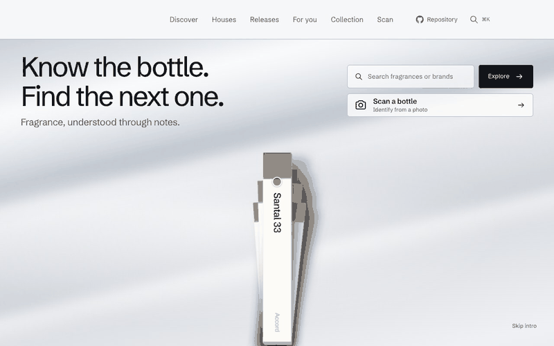
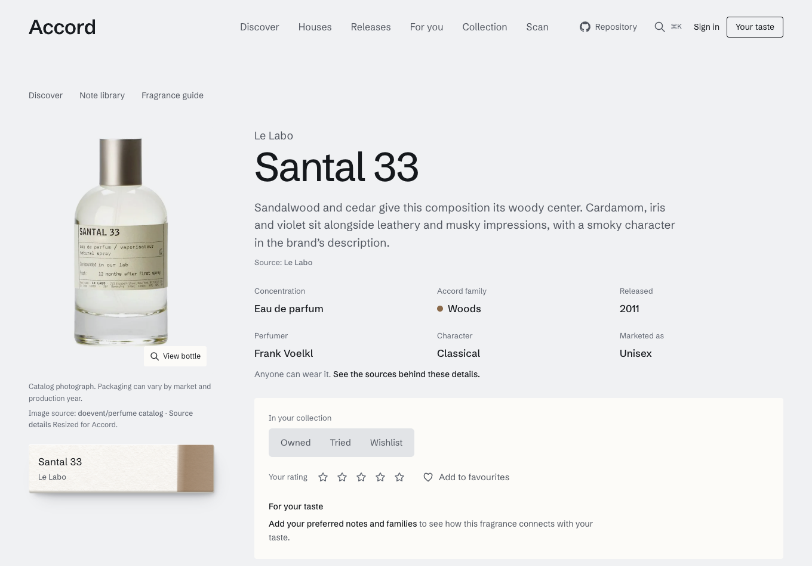
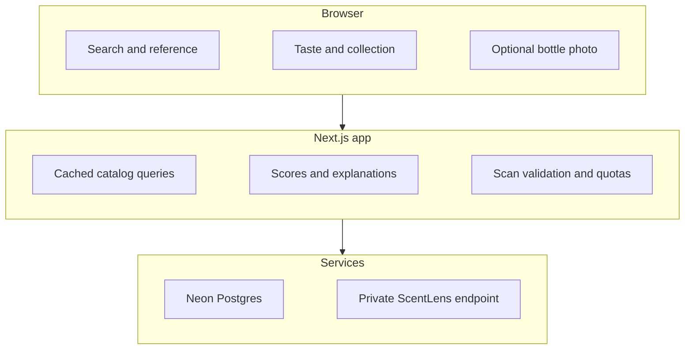

# Accord

**Explore fragrances through their notes, then get suggestions that explain how they connect to your taste.**

**[Try it → accord.bhanusadhu.com](https://accord.bhanusadhu.com)** · Browse, compare and build a collection without signing up.



Search and recommendations are live. Bottle scanning depends on ScentLens, whose free hosting allowance is currently exhausted. External community ratings and wear statistics are not part of the live product.

## The problem

Someone who likes several very different fragrances needs more than a list of popular bottles.
They need to understand which notes and characteristics connect their favourites, distinguish similar editions, and remember what they have tried.
Accord combines a searchable fragrance reference with a personal collection and recommendations grounded in those choices.

**The goal: find something worth trying and understand why it was suggested.**

## How it works

1. **Start with something familiar.** Search a name or house, use quick find, or explore notes, families and catalog releases.
2. **Read the exact edition.** Compare catalog notes with sourced top, heart and base stages where available. Source links distinguish published facts from editorial guidance and calculated similarities.
3. **Build a taste profile.** Choose favourite fragrances, preferred families and notes to like or avoid. The profile works with only a few choices.
4. **Inspect your recommendations.** Each pick names relevant notes or fragrances you already like. A match number is a relative position in your eligible catalog, not a probability of enjoyment.
5. **Keep a personal record.** Move fragrances among Owned, Tried and Wishlist, add ratings and favourites, and let those choices change future suggestions. Sign in when you want cross-device persistence.



The live reference currently contains **24,661 searchable fragrances**. Its coverage is uneven and visible:

| Supported detail | Live catalog coverage |
| --- | ---: |
| Additional sourced research | **628 entries** |
| Documented note stages | **610 entries** |
| Attributed wear guidance | **9 entries** |
| Perfumer credits | **12 entries** |
| Bottle photographs | **24,649 entries** |

The [catalog guide](https://accord.bhanusadhu.com/learn#catalog) reports coverage from the database. Missing metadata remains "Not listed"; a flat note list is never presented as an invented pyramid.

## Product decisions

| Decision | Trade-off |
| --- | --- |
| Recommend from catalog content and personal choices | Works before a community exists, but there is no evidence yet that note similarity predicts a particular person's enjoyment. |
| Treat avoided notes as hard exclusions | Removes unwanted material from the list instead of merely lowering its score. Sparse or inaccurate catalog notes still limit that filter. |
| Explain every recommendation | Named notes and liked fragrances make the result inspectable. A simple explanation cannot capture every nuance of how a perfume smells on skin. |
| Keep ratings personal | Collection ratings improve the visitor's own profile. Public reviews, votes and popularity charts were retired rather than filled with unsupported numbers. |
| Attribute reference enrichment | Exact-edition checks and explicit sources make note stages and wear guidance useful. Coverage grows more slowly than an unrestricted bulk import. |
| Gate recognition separately | Search and collection remain useful when ScentLens is unavailable. Quotas and a private endpoint protect the free allowance, but shared hosting limits can still stop scans. |

## Architecture



The browser holds guest state; authenticated writes use the verified server session and Postgres.
Recommendation scoring runs on the server over a catalog index. Photos are resized in the browser and sent through a bounded, authenticated recognition path when that service is available.
[Architecture](docs/ARCHITECTURE.md) and [production operations](docs/OPERATIONS.md) describe caching, account ownership and scanner limits.

## Hard problems

**Representing someone with several different favourites.** A single average taste vector can dilute separate interests, such as citrus and woody fragrances.
The [recommender](src/lib/reco/recommend.ts) blends note fit with similarity to the closest liked fragrance, a small graph term and accord/family signals.
In the recorded line-holdout proxy, adding the nearest-liked term improved Hit@24 from **9.0% to 12.0%**. The graph term did not improve that top-list metric; it reduced median rank from **2,820 to 2,717**.

**Adding reference detail without merging different editions.** A familiar name may refer to several concentrations, launch years or flankers.
The [note-stage matcher](src/lib/catalog/match-note-stages.ts) checks house and full name, rejects conflicting editions and retains source assignments rather than guessing stages from ingredients.
A review of **52 source pages** excluded **3 unresolved edition or year conflicts**. The live catalog now has **610 entries with stages**, while original catalog notes remain the recommendation inputs. [Research workflow](docs/CATALOG-RESEARCH.md).

**Making a scan failure safe for the rest of the app.** The [scan service](src/lib/scan) validates images, leases capacity, consumes quotas atomically and validates the recognizer's result.
Cached photo fingerprints can reuse results for **24 hours** without another upstream call. Requests are limited to **2 MiB**; the private service processes one input at a time and idles down after **30 seconds**.
An abstention is always returned without a confirmed product ID. A successful earlier integration call established the contract, while the present hosting outage demonstrates why scanning must stay independent of discovery.

**Preserving ownership across guest and account state.** Guest collections merge into a verified account, while server queries take ownership from the session rather than a supplied user ID.
PGlite integration tests exercise the actual database paths for isolation and deletion. Recovery uses expiring single-use tokens and session revocation; operational checks include an encrypted backup restore drill. [Account and persistence code](src/lib).

## Results

The recommendation experiment is a reproducible proxy, not a study of human taste: like four fragrances from one product line, hide a fifth, and rank it among the remaining catalog.
It runs **300 trials** with seed **42** over a **24,642-fragrance** evaluation catalog, which predates the additional sourced editions.

| Recorded variant | Hidden item in top 24 | Hidden item in top 100 | Median rank |
| --- | ---: | ---: | ---: |
| Random ordering | **0.3%** | **0.3%** | **12,713** |
| Note similarity only | **9.7%** | **14.3%** | **3,776** |
| First blend without nearest-liked similarity | **9.0%** | **14.0%** | **3,549** |
| Shipped blend | **12.0%** | **16.3%** | **2,717** |

Brand and fragrance name are not recommender inputs. The first blend underperformed notes alone, and even the shipped result misses most hidden items at the top of the list.
Flankers are an imperfect taste proxy; the experiment supports comparison between methods, not an enjoyment claim. [Full evaluation](docs/EVALUATION.md).

**116 tests pass on `main`**, with typecheck and lint also passing.
The suite covers recommendation behavior, catalog parsing and edition matching, scan validation and quotas, account boundaries and retained-data deletion.
Browser tests separately cover discovery, collection, recovery, reference imagery, keyboard access and reduced motion; scanner journeys use a development mock rather than consuming live inference quota.

Live checks confirmed the catalog coverage above, visible source attribution and the personal collection controls.
There are no measured user counts, save-rate improvements, retention figures or recommendation-satisfaction results.

## How it was built

1. **Make the catalog explorable.** Stable IDs, normalized notes, Postgres fuzzy search and family filters established browsing without an account.
2. **Connect feedback to recommendations.** Collections and taste profiles fed an explainable scorer; an offline comparison exposed the first blend's weakness and motivated nearest-liked similarity.
3. **Separate recognition from discovery.** ScentLens integration added structured uncertainty, quotas, caching and a private inference endpoint.
4. **Grow a sourced reference.** Note pages, house browsing, edition links, photographs and source-assigned note stages added research depth while retaining provenance.
5. **Remove community dependencies.** Public ratings, reviews, votes and charts were retired. Personal ratings stayed as private recommendation inputs, and release browsing uses catalog years.
6. **Investigate external data carefully.** A ten-fragrance ScentRev trial produced response samples, but backend access, methodology and reuse questions remain unresolved. No trial values were published as community activity.

## Tech stack

| Layer | Technology |
| --- | --- |
| Interface | Next.js App Router, React, TypeScript, Tailwind CSS, Lenis with reduced-motion support |
| Search and data | PostgreSQL trigram search, Drizzle, cached catalog queries |
| Recommendations | IDF note vectors, nearest-liked similarity, personalized PageRank and MMR diversity |
| Accounts | Better Auth, verified sessions, guest-to-account merge |
| Recognition | ScentLens through a private Modal endpoint; structured result validation with Zod |
| Verification | Vitest, PGlite database integration tests, Playwright and axe |
| Hosting | Vercel Hobby and Neon Free; scanning shares a limited free Modal allowance |

## Run it locally

```bash
# Node.js 24. Install dependencies and copy the example configuration.
npm ci
cp .env.example .env

# Set BETTER_AUTH_SECRET and the local ScentLens products.csv path in .env.
# Terminal 1: start persistent local Postgres through PGlite.
npm run db:server

# Terminal 2: create the schema, seed the base catalog and start Next.js.
npm run db:migrate
npm run db:seed
npm run dev

# In another terminal: typecheck, lint and run unit/integration checks.
npm run typecheck && npm run lint && npm test

# Install Chromium, then run the browser journeys with the test scanner.
npx playwright install chromium
npm run test:e2e
```

[.env.example](.env.example) lists local database, auth and optional scanner settings. Seeding requires the ScentLens text export, which is not committed here; sourced additions follow the [research import workflow](docs/CATALOG-RESEARCH.md). [Catalog image restoration](docs/CATALOG-IMAGES.md) is separate from the CSV. Pushes to `main` trigger Vercel; production builds apply pending additive migrations before building the app.

## Project structure

```text
src/app/                 Routes, server actions and JSON APIs
src/components/          Fragrance strips, reference views and scanner
src/lib/catalog/         Catalog queries, research imports and edition checks
src/lib/reco/            Taste model, scoring, graph and explanations
src/lib/scan/            Image checks, quotas, cache and ScentLens client
src/lib/collection/      Private collection persistence
src/db/                  Catalog and account schemas
scripts/                 Database setup, research imports and evaluation
tests/                  Database integration and browser journeys
data/research/          Reviewed source manifests and audit records
docs/                   Architecture, evaluation and source boundaries
deploy/                 Private scanner deployment
```

## What's next

- **Scanning:** the endpoint remains integrated, but exhausted shared hosting credit prevents live recognition. The search fallback and recorded ScentLens demo remain available.
- **Community data:** no public ratings, reviews, wear votes or popularity statistics are live. The [source feasibility review](docs/SOURCE-FEASIBILITY.md) records the unresolved ScentRev trial; its [separate preview branch](https://github.com/bhnsadhu/accord/tree/feat/scentrev-preview) is not production integration.
- **Coverage:** researched editions, note stages and perfumer credits cover a subset of the catalog. Release browsing reflects listed catalog years, not a complete feed of new launches.
- **Images:** most bottle photos come from the source dataset. Its MIT label does not independently verify photographers' permissions; the product discloses that limitation alongside the images. [Image provenance](docs/CATALOG-IMAGES.md).
- **Quality:** recommendation fit is relative, and note-based accord profiles estimate associations rather than ingredient percentages. Confirm preferences by sampling the fragrance.
- **Next measurements:** search-to-detail completion, recommendation saves and rejected suggestions, then evaluate those outcomes before adding collaborative ranking or expanding external-data claims.

[Architecture](docs/ARCHITECTURE.md) · [Evaluation](docs/EVALUATION.md) · [Catalog research](docs/CATALOG-RESEARCH.md) · [Source feasibility](docs/SOURCE-FEASIBILITY.md) · [Operations](docs/OPERATIONS.md)
