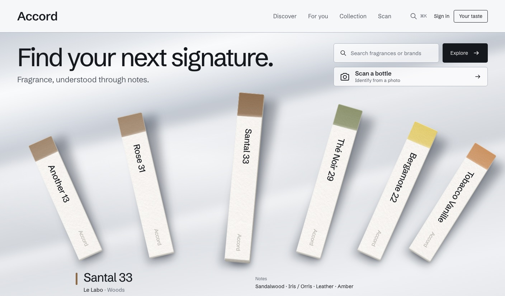
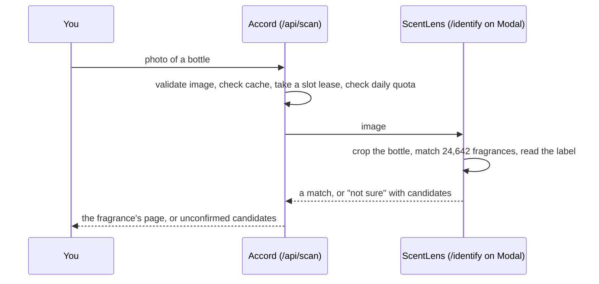

<p align="center"></p>

# Accord

**Know the bottle. Find the next one.** A fragrance discovery app that names a bottle from a photo, explains what is in it, and recommends what to try next, with the evidence behind every suggestion.

**[Try it → accord.bhanusadhu.com](https://accord.bhanusadhu.com)** · free, no sign-up needed



## The problem

People who love perfume research constantly: they see a bottle at a friend's place and want to know what it is, they want something like the one they love, and they want to understand the notes. The tools they use either sell bottles, rank by popularity, or hand out recommendations with no reason given. Accord answers five questions in one place:

- *What fragrance is this?* Photograph a bottle; [ScentLens](https://scentlens.bhanusadhu.com) identifies it, or says it isn't sure.
- *What can I learn about it?* Read its catalog profile, open note explanations, follow a note into other fragrances, and use the fragrance guide to understand the terminology.
- *What would I like?* Recommendations from your favourites, ratings and notes, each with the evidence behind it.
- *What smells like my favourite?* Similar fragrances by shared notes, accord family and character, with a side-by-side comparison.
- *How do I organise my collection?* Owned, tried and wishlist shelves, ratings and favourites, and a summary of what your shelves say.

It works without an account; signing in keeps your collection on every device.

## What's in it

| Area | What it does |
|---|---|
| Catalog | 24,661 fragrances, including 19 researched additions, among them recent 2025 and 2026 launches, to the original ScentLens catalog. Bottle photographs cover 24,649 entries, with source attribution and the dataset's permission limitation disclosed (see [Data](#data) and [Catalog photographs](docs/CATALOG-IMAGES.md)). |
| Reference | 25 sourced fragrance profiles, documented note stages and wear guidance where available, related editions, 66 concise note definitions, bottle enlargement, 16 licensed note photographs, and a searchable note library. Quick find, Discover previews and comparison include bottle thumbnails. Sources and scope: [docs/FRAGRANCE-REFERENCE.md](docs/FRAGRANCE-REFERENCE.md) and [docs/CATALOG-IMAGES.md](docs/CATALOG-IMAGES.md). |
| Search | Postgres `pg_trgm` search with typos, accents, aliases and exact formats. Filter by multiple included/excluded notes, family, concentration, perfumer and gender label. Missing fragrances can be requested privately. |
| Recommendations | Explainable content-based engine in TypeScript: IDF-weighted note vectors, accord and family overlap, similarity to your nearest favourite, and a personalized PageRank walk over the fragrance-note graph. Diversified with MMR. Evaluated offline against ablations ([docs/EVALUATION.md](docs/EVALUATION.md)). |
| Members | Member rating and owned, tried and wanted totals from collections; wear votes for longevity, sillage, season, time of day, how it reads and value; written reviews with helpful marks and reporting; "reminds me of" links; "members who have this also have"; ratings on search results and a weighted "Top rated" sort; public member pages that list reviews only. Everything starts at zero and is never seeded. |
| Reference pages | Every house with its family mix, signature notes, perfumers and full line; credited perfumers; charts for top rated, most owned, most wanted and most reviewed, latest reviews, newest releases and release years; an accord profile on each fragrance estimated from its notes. |
| Collections | Shelves, 1 to 5 ratings, favourites. Guests keep them in local storage; on sign-in they merge into the account. Ratings change later recommendations. |
| Scanner | Server-side client for the ScentLens `/identify` API with image validation, Postgres-backed daily quotas, concurrency leases and a result cache. Live, with daily caps sized to a $1/month compute budget ([COSTS.md](COSTS.md)). |
| Accounts | Better Auth (email and password, optional GitHub), rate limited, with full account deletion. |

## Product decisions

| Decision | Trade-off |
| --- | --- |
| **Explainable, content-based recommendations; no collaborative filtering** | There is no real interaction data, and faking users would fake the personalization. Content signals work from the first visit and can always say why: shared notes, a named favourite, an accord. |
| **Match scores are percentiles, never probabilities** | "Top 3% for you" is honest about what the model knows. A "92% you'll love it" would claim a calibration nobody has measured. |
| **An unsure scan is never shown as a match** | ScentLens can abstain, and Accord shows its candidates as unconfirmed "ghost" strips. A wrong name costs more trust than "not sure". |
| **Useful before sign-up** | Guests keep shelves and ratings on the device, merged into the account on sign-in, with the account winning conflicts. |
| **No prices; reviews and ratings only from members** | The catalog has no prices, reviews or popularity, so none are implied. Member numbers are counted live and shown with their counts, starting from zero. Accord is a reference, not a store. |
| **Scanner capped to a $1 a month budget** | A few scans per visitor per day keep a free project free. The page explains the shared limit instead of failing silently. |
| **A recognizable visual world** | Fragrances appear as paper smelling strips on an evaluation bench, stained by accord family, so the interface reads like a perfumer's desk rather than a dashboard. |

## How ScentLens powers the scanner

Accord and ScentLens are separate projects on purpose. ScentLens is the recognition model, with its own data, evaluation and hosting on Modal. Accord is the product around it: it owns the photo, the limits, and what the result means on screen.



Keeping the model behind an HTTP contract means each side can change on its own: ScentLens can retrain without touching Accord, and Accord can change limits or the interface without redeploying a model. The contract was verified live against production ([docs/EVALUATION.md](docs/EVALUATION.md#scentlens-integration)); accuracy figures belong to ScentLens and live in its repository.

<p align="center"></p>

## Results

The recommender was evaluated offline over 300 trials: a simulated person likes four fragrances from one product line, a fifth is hidden, and the test records where it ranks among about 24,600 fragrances. Brand and name are never inputs, so the task cannot be won by reading the label ([docs/EVALUATION.md](docs/EVALUATION.md)).

| Variant | Hit@24 | Median rank |
| --- | --- | --- |
| Random order | 0.3% | 12,713 |
| Notes only (IDF cosine) | 9.7% | 3,776 |
| First blend I wrote | 9.0% | 3,549 |
| **Shipped blend** (plus nearest favourite and a small graph walk) | **12.0%** | **2,717** |

The first blend did worse than notes alone at the top of the list. Adding similarity to the single closest favourite gave the biggest gain, so that version shipped. Product lines are only a proxy for taste, so absolute hit rates are low and are read comparatively; nothing here measures enjoyment.

## Stack

Next.js 16 (App Router, Cache Components) · React 19 · TypeScript · Tailwind CSS 4 · Drizzle ORM · Postgres (Neon in production, PGlite locally) · Better Auth · Vitest · Playwright · Vercel Hobby.

## Architecture

```
Browser ──► Next.js on Vercel
             ├─ Server components: catalog pages, cached with "use cache"
             ├─ /api/recommendations ─► in-memory catalog index ─► recommender (src/lib/reco)
             ├─ /api/scan ─► validate ─► cache ─► slot lease ─► quota ─► ScentLens on Modal
             ├─ Server actions: collection and profile writes (session user only)
             └─ Better Auth
                     │
                     ▼
                Postgres (Neon): catalog, users, collections, profiles, scan counters
```

More in [docs/ARCHITECTURE.md](docs/ARCHITECTURE.md).

## Run it locally

Requirements: Node 22+. No Docker or cloud accounts.

```bash
npm install
cp .env.example .env            # then set BETTER_AUTH_SECRET (openssl rand -base64 32)
npm run db:server               # local Postgres (PGlite) on :5433; keep it running
npm run db:migrate
npm run db:seed                 # reads the ScentLens export; see SCENTLENS_PRODUCTS_CSV
npm run catalog:images          # restore the pinned catalog photographs for local development
npm run dev
```

The seed reads `products.csv` from a local ScentLens checkout (`artifacts/export/products.csv`); the file is not redistributed here.

Catalog photographs are stored in a pinned GitHub release rather than Git source history. `npm run catalog:images` downloads and verifies the archive once; `npm run build` restores it automatically. See [Catalog photographs](docs/CATALOG-IMAGES.md) for provenance and maintenance.

## Quality

* **93 Vitest tests** (unit and integration) against an in-memory Postgres per run: similarity properties, IDF weighting, cold start, disliked-note exclusion, rating-driven re-ranking, evidence-based explanations, search parsing, catalog and collection writes, scanning and quotas, and security.
* **44 Playwright tests across 12 specs**, on desktop and mobile, with axe accessibility checks. The scanner is mocked, so the suite never calls ScentLens.

```bash
npm run typecheck && npm run lint
npm test             # unit + integration (in-memory Postgres per run)
npm run test:e2e     # Playwright, desktop and mobile; scanner mocked, never calls ScentLens
npm run build
npx tsx scripts/evaluate-reco.ts   # offline recommender evaluation
```

## Data

The original catalog is the Hugging Face dataset `doevent/perfume`, cleaned by ScentLens. Accord uses its text metadata and 24,647 exact brand and full-name image matches. The dataset is labelled MIT but does not document individual photographers' permissions. The owner approved attributed publication of this image batch with that limitation disclosed on 2026-11-01. Two independently licensed photos fill source-dataset gaps, bringing coverage to 24,649 entries; Sauvage Parfum, Tobacco Vanille Parfum and the 10 additions from 2026-11-04 retain paper specimens. This audit checks source identity and file integrity, with visual spot checks, rather than independently verifying every bottle label.

A separate sourced research layer supplies original summaries and independently licensed reference photographs. Image sources, credits, licenses and the publication decision are recorded in [the media manifests](data/media) and [CATALOG-IMAGES.md](docs/CATALOG-IMAGES.md); [IMAGERY.md](docs/IMAGERY.md) documents the earlier licensed reference layer. The batch exception supersedes that document's earlier verified-license-only constraint for these catalog photographs. Copied source-dataset descriptions are not used. There are no prices, reviews, popularity or ratings beyond your own, and none are implied.

## Deployment

Vercel Hobby (Git-connected: every push to `main` deploys production) with Neon Free provisioned through the Vercel Marketplace, served at `accord.bhanusadhu.com`. Migrations and the catalog seed run from a local machine against the unpooled Neon URL (`vercel env pull`). Costs and limits: [COSTS.md](COSTS.md).

## Known limits

- Most entries still have catalog facts only. Research coverage is shown on `/learn`; note stages and wear guidance appear only where sourced.
- Recommendation quality is evaluated offline on a proxy task; there is no real-user data yet.
- Scanning is capped at a few scans a day to stay within a $1/month free compute budget; a cold ScentLens container takes up to a minute.
- Flankers missing from the catalog can be identified as a catalog sibling (a documented ScentLens limit).

## Credits

- Recognition: [ScentLens](https://scentlens.bhanusadhu.com), a separate project.
- Similarity and graph recommendation methods adapted from Fragrance DNA by mikeyoknow (MIT). See [THIRD_PARTY_NOTICES.md](THIRD_PARTY_NOTICES.md).
