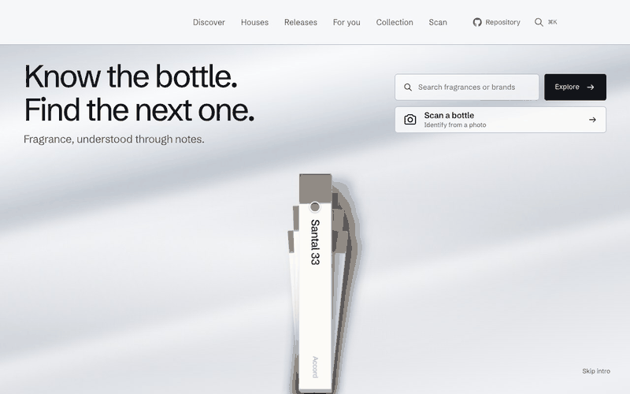
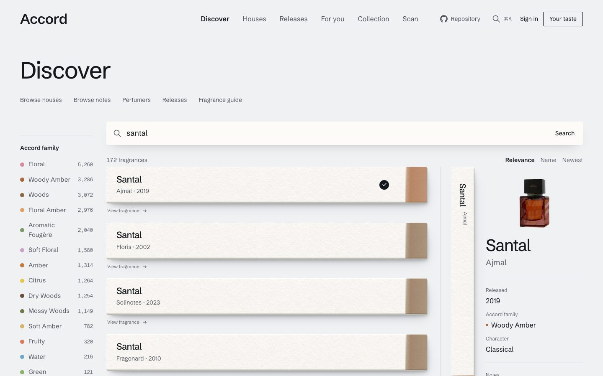
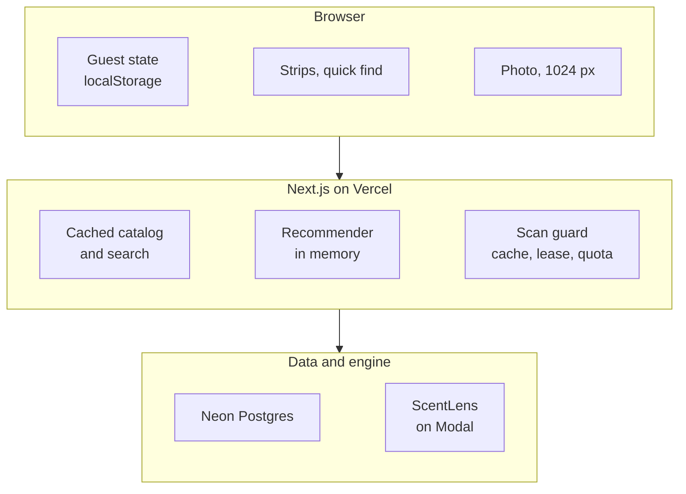
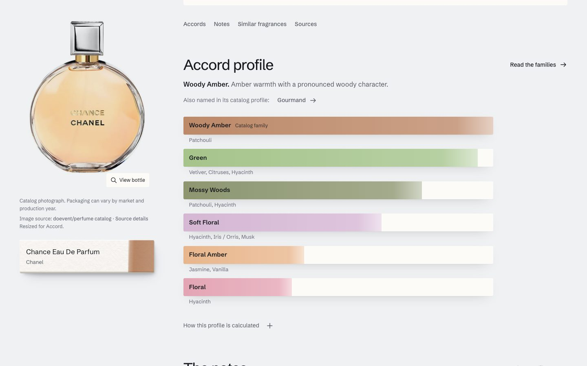

<p align="center"></p>

# Accord

**Find a fragrance, identify a bottle from a photo, and get picks that name the notes and favourites behind them.** Search 24,661 fragrances with a clear reason attached to every suggestion.

**[Try it → accord.bhanusadhu.com](https://accord.bhanusadhu.com)** · free, no sign-up needed to browse, search and get recommendations




## The problem

People who collect fragrance already know a few notes and a few favourites, then lose hours across review sites and forums trying to answer three questions: what is this bottle, what would I like, and what smells like the one I love. Most tools answer with a popularity chart and no reasoning, and a bottle in your hand has no search box at all.

Accord aims for one outcome: **a visitor finds a fragrance they want to try and understands why it was suggested.**

## How it works

1. **Find.** Quick find (`⌘K`) and Discover search by name, alias, house, accord family and included or excluded notes, tolerant of typos.
2. **Learn.** Each fragrance page shows sourced facts, an accord profile estimated from its listed notes, pictured notes, and top, heart and base stages only where a source assigns them.
3. **Collect.** Mark a bottle Owned, Tried or Wishlist, rate it, and set liked and avoided notes. Guests keep this in the browser and it merges into an account on sign-in.
4. **Get picks.** "For you" ranks the catalog and says why: the notes you like that a pick contains, and the favourite it resembles. The match is a percentile, never a probability.
5. **Scan.** Photograph a bottle. [ScentLens](https://github.com/bhnsadhu/scent-lens) names it or says it is not sure, and an unsure result shows ghost strips instead of an answer.



## Product decisions

| Decision | Trade-off |
| --- | --- |
| **Useful before sign-up** | Guest state lives in `localStorage`, so it is lost if the browser is cleared, in return for zero friction. It merges into the account on first sign-in. |
| **Explain every pick, never score it as a probability** | "Top 1%" means a pick outscored 99% of eligible fragrances. It sounds less impressive than "97% match" and is true. |
| **Text and sourced facts only, "Not listed" when unknown** | Many pages look sparse: only 12 entries name a perfumer and 610 carry sourced note stages out of 24,661. In return nothing on a page is invented. |
| **Scanner behind hard caps** | Three scans a day across the whole site, so most visitors cannot scan. That keeps spend at $0 on a free Modal credit, and a paused scanner says so and points to the ScentLens demo. |
| **Built member ratings and reviews, then removed them** | Public ratings, reviews and charts needed real contributors Accord does not have, so they were retired. Private shelves and ratings stay, and every public page now reads catalog data only. |
| **One visual system, strips on a bench** | Every list is a smelling strip stained by its accord family. It is distinctive and costs some density compared with a plain table. |

## Architecture



Pages prerender from `"use cache"` catalog reads, the recommender builds a sparse note index once per server instance, and only the scan route talks to ScentLens. Details in [docs/ARCHITECTURE.md](docs/ARCHITECTURE.md).

## Hard problems

**Recommending with no interaction data.** Accord has no user history to learn from, so collaborative filtering was off the table. The recommender in [src/lib/reco](src/lib/reco) is content-based: smoothed IDF note vectors, accord similarity, similarity to the closest liked fragrance, and a small personalized PageRank term, diversified with MMR. To check it, a script hides one fragrance from a line the simulated person likes (Chanel Chance, Dior Sauvage) and ranks it among about 24,600 others. My first blend scored worse than notes alone at the top of the list. Adding the nearest-liked term lifted **Hit@24 from 9.0% to 12.0%**, so it shipped.

**A scanner that cannot overspend.** ScentLens runs on a free Modal credit with a $1 monthly limit, so [src/lib/scan](src/lib/scan) treats every call as money. A kill switch comes first, then size and magic-byte checks, a 24-hour result cache keyed by image hash, two concurrency slots taken with `FOR UPDATE SKIP LOCKED`, and quotas consumed in one transaction for the site, the account and the guest. An abstained result is forced to `product_id: null` so the UI cannot show it as an answer. A production cold scan took **29.9 s**, and unauthorized calls get a 401 before any compute starts.

**Showing only what a source supports.** Catalog notes are a flat list, but people expect a top, heart and base pyramid. [scripts/prepare-note-stages.ts](scripts/prepare-note-stages.ts) matches an open dataset by house and full name and rejects conflicting concentrations or years, ambiguous editions and incomplete pyramids. Entries with no source keep the flat list and say "Not listed". Accord profile bars are labelled as estimates, with the method one click away. See [docs/CATALOG-RESEARCH.md](docs/CATALOG-RESEARCH.md).

**24,649 bottle photos without bloating Git.** The optimized images ship as a pinned GitHub release asset. `npm run build` downloads it, checks size and SHA-256, rejects unexpected paths and restores the files, so the repository stays small and builds stay reproducible. See [docs/CATALOG-IMAGES.md](docs/CATALOG-IMAGES.md).



## Results

- **116 unit and integration tests in 14 files** (Vitest). The integration tests run the real `pg` driver over in-memory PGlite and cover cross-user isolation, cascade deletion on account removal, scan quotas and leases, and security rules.
- **74 Playwright tests in 14 files** across desktop and mobile, with the scanner mocked. They include accessibility checks with axe against WCAG 2.2 AA, account recovery, guest and account collections, and quick find.
- **Recommender, offline line hold-out** (seed 42, 300 trials, 24,642 fragrances at the time): Hit@24 **12.0%** against 0.3% for random order, median rank **2,717** of about 24,600. This is a proxy. Flankers share notes, so it rewards note similarity and says nothing about enjoyment. Full table in [docs/EVALUATION.md](docs/EVALUATION.md).
- **Ranking latency:** about **40 ms** for a full ranking of the catalog on a laptop, single thread.
- **Live scan check:** one real photo returned the right fragrance at confidence 0.999 in 21.6 s with a cold container. One photo is a contract check, not an accuracy measurement. Scanner accuracy is measured and reported in the [ScentLens repository](https://github.com/bhnsadhu/scent-lens).
- **Production hardening:** zero known findings in the production dependency audit, and an encrypted daily backup restored in a PostgreSQL 18 drill, all 18 tables verified. See [docs/OPERATIONS.md](docs/OPERATIONS.md).

**Not measured:** real users, satisfaction or whether the picks are enjoyed. No users, ratings or testimonials are shown anywhere because none exist.

## How it was built

- **The engine first.** Schema, catalog seed from the ScentLens export, fuzzy search, the recommender with its evaluation script, then collections and taste profiles.
- **Scanner behind a guard.** The ScentLens client, validation, quotas and leases landed before any interface for it, and were sized to the verified $1 Modal budget.
- **A visual world.** After three explored directions, the strips-on-a-bench direction was chosen and applied everywhere, then a finish review fixed eight material problems and two regressions.
- **Production.** Verified email accounts, expiring recovery links, backups, security headers and a restore drill, deployed on Vercel and Neon at $0.
- **A reference, not just a recommender.** Licensed and attributed photos for 24,649 bottles, pictured notes, sourced note stages and attributed wear guidance.
- **A turning point.** Ratings, reviews, wear votes and charts were built, shipped, then retired when the product no longer depended on anyone's contributions. The legacy tables remain so stored data and account deletion keep working.

## Tech stack

| Layer | Technology |
| --- | --- |
| Frontend | Next.js 16 (App Router, `cacheComponents`), React 19, TypeScript strict, Tailwind 4, Lenis |
| Backend | Next.js route handlers and server actions, Better Auth, zod |
| Data | PostgreSQL with `pg_trgm`, Drizzle ORM, `pg` driver. Neon in production, PGlite locally |
| Recognition | ScentLens (OWLv2, SigLIP 2, OCR) on Modal, called with `@gradio/client` |
| Testing | Vitest, Playwright, axe-core |
| Hosting | Vercel Hobby and Neon Free, $0 ([COSTS.md](COSTS.md)) |

## Run it locally

```bash
npm install
npm run db:server                     # PGlite on 127.0.0.1:5433, keep it running
npm run db:migrate && npm run db:seed # needs the ScentLens products.csv, not committed
npm run dev                           # http://localhost:3000, scanner off unless SCANNER_MODE is set
npm run typecheck && npm run lint && npm test
npm run test:e2e                      # builds and serves on :3200 with the scanner mocked
npx tsx scripts/evaluate-reco.ts      # offline recommender evaluation
```

Environment variable names are listed in `.env.example`. Pushing to `main` deploys to Vercel, and production builds apply pending migrations first.

## Project structure

```text
src/app/          routes: discover, fragrance, for-you, collection, scan, houses, releases
src/components/   the strip module, quick find, scanner, profile builder
src/lib/reco/     recommender: index, similarity, scoring, graph, explanations
src/lib/scan/     ScentLens client, image checks, quotas, leases, cache
src/lib/catalog/  parsing, seeding, cached queries, accord profile
src/db/           Drizzle schema
drizzle/          SQL migrations
scripts/          seed, migrate, evaluation, catalog research import
tests/            integration (PGlite) and e2e (Playwright)
docs/             architecture, decisions, evaluation, operations
```

## What's next

**Known limits**

- The source catalog ends in early 2024. Later launches are added by hand, and only when sourced.
- Sparse pages are common: 12 entries have a named perfumer, 610 have sourced note stages and 9 have wear guidance.
- Bottle photos come from a dataset labelled MIT whose individual photographers' permissions are undocumented. The limitation is disclosed on the site.
- The scanner is capped by a free credit shared with the ScentLens demo, and a cold scan takes about 30 s.
- The logo is a placeholder.

**Next:** more sourced note stages and perfumers in batches, a real-photo accuracy check of the scanner inside Accord, and a measure of whether explanations change what people try.

[Architecture](docs/ARCHITECTURE.md) · [Decisions](docs/DECISIONS.md) · [Evaluation](docs/EVALUATION.md) · [Operations](docs/OPERATIONS.md) · [Catalog research](docs/CATALOG-RESEARCH.md) · [Costs](COSTS.md)
