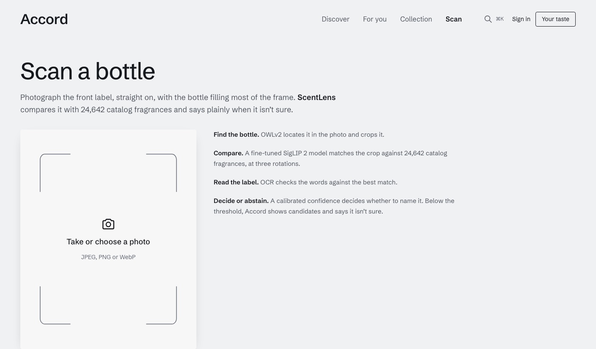
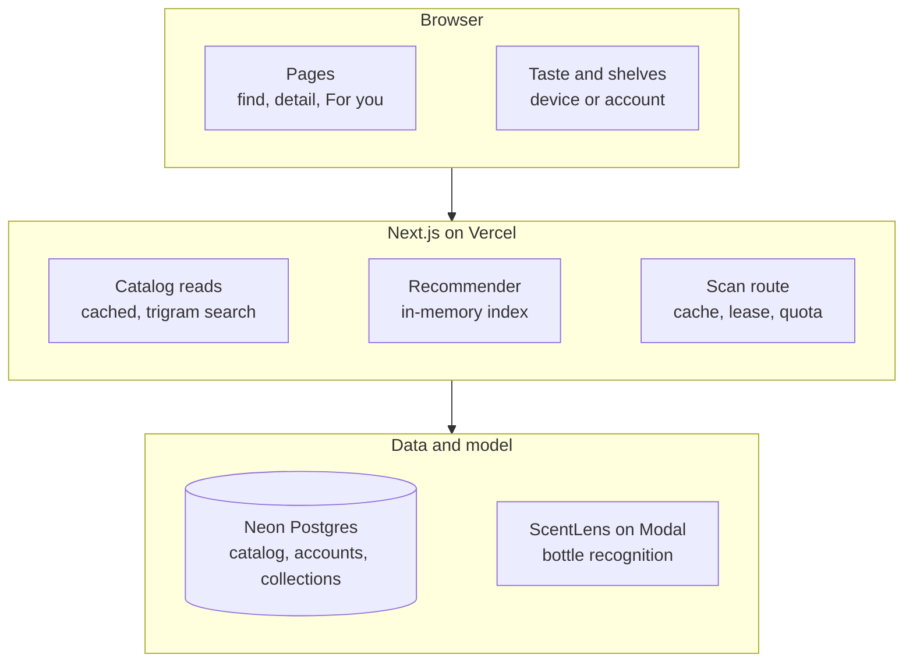

<p align="center"></p>

# Accord

**A fragrance discovery app that explains itself.** Search 24,651 fragrances, identify a bottle from a photo, and get recommendations that say exactly which notes and favourites they come from.

**[Try it → accord.bhanusadhu.com](https://accord.bhanusadhu.com)** · works as a guest, no sign-up needed.


## The problem

People who love fragrance spend hours researching what to try next, but the big reference sites are cluttered forums, and their recommendations are either popularity lists or a black box. In a store or at a friend's place, the first question is usually "what is this?", and the answer means squinting at a label or asking around.

The goal: **a visitor finds a fragrance they want to try, and understands why it was suggested.**

## How it works

1. **Find.** Quick find (⌘K) searches names, houses and aliases and tolerates typos; Discover filters by notes to include or avoid.
2. **Identify.** Photograph a bottle and [ScentLens](https://scentlens.bhanusadhu.com), a separate recognition model, names it from the catalog, or says it isn't sure.
3. **Understand.** Each fragrance page shows its accord family, notes, an estimated accord profile, sourced facts (or "Not listed"), and similar fragrances.
4. **Collect.** Mark bottles as Owned, Tried or Wishlist and rate them. It works on the device as a guest and merges into an account on sign-in.
5. **Get picks.** For you ranks the whole catalog for your taste and explains every pick with the notes and favourites it shares.

<p align="center"></p>

## Product decisions

| Decision | Trade-off |
| --- | --- |
| **Content-based picks, no collaborative filtering** | It can't learn "people who liked X also liked Y". There is no real interaction data to learn from, and faking it would fake the personalisation. |
| **Match is a percentile, not a promise** | "Top 1%" sounds less exciting than "98% match". It is honest: the fragrance outscored 99% of the catalog for this taste, which says nothing certain about whether you'll love it. |
| **The scanner may say "Not sure"** | Fewer photos get a name. But an unsure guess shown as an answer would cost more trust than it buys, so uncertain candidates appear as faint, unstained strips. |
| **Useful before sign-up** | Guests keep their taste and shelves only on the device. In return anyone can browse, search and get picks on the first visit; signing in merges what they did. |
| **Useful without a community** | Discovery uses catalog facts and attributed research. Unsupported ratings, reviews and votes are omitted; personal ratings still improve the visitor’s own recommendations. |
| **Not a store** | No prices or retailer links, so no obvious way to earn money. It keeps the product about understanding fragrance, not selling it. |

## Architecture



Catalog pages are prerendered and cached, and refreshed when the data changes. The recommender builds a note index of the whole catalog once per server instance and ranks all 24.6k fragrances in about **40 ms**. Every write takes the user from the verified session, never from the request. → [docs/ARCHITECTURE.md](docs/ARCHITECTURE.md)

## Hard problems

**Recommending with no usage data.** With no interaction data there's no ground truth for "would this person enjoy it", so the recommender was judged on a proxy: like four fragrances from one line (say, four Dior Sauvage flankers), hide a fifth, and see where it ranks among 24.6k. The first blend scored *worse* than notes alone at the top of the list. Adding similarity to the single closest liked fragrance lifted the hit rate in the top 24 from **9.0% to 12.0%**, against **0.3%** for random order. → [docs/EVALUATION.md](docs/EVALUATION.md), [`src/lib/reco`](src/lib/reco)

**A scanner that can't run up a bill.** Recognition runs on a GPU service with a hard monthly limit. Every request passes a kill switch, a size and format check, and a 24-hour cache keyed by the photo's hash. It then needs one of two slots (leased with `FOR UPDATE SKIP LOCKED`) and an atomic quota check across global, account and guest scopes. Only then does it call the model. Abstentions can never be displayed as answers. → [`src/lib/scan`](src/lib/scan)

**Turning messy catalog text into structure.** The source lists accords as phrases like "Woody Amber Fresher Citrus". A parser maps each to an Edwards-wheel family, a character and facets, renames the legacy "Oriental" to "Amber", and drops stray perfumer names. The catalog has no accord strengths, so the profile bars are estimated from how strongly each listed note leans toward a family across the catalog, and are labelled as estimates. → [`src/lib/catalog`](src/lib/catalog)

**Reference data without a community dependency.** Published wear guidance carries a named source and checked date. Seasonal guidance for two exact editions was retrieved through Scento’s public API. Unavailable ratings, reviews, votes and public profiles are removed; releases and note-based similarity work from the catalog. → [docs/CATALOG-RESEARCH.md](docs/CATALOG-RESEARCH.md)

## Results

| Recommender variant (line hold-out, 300 trials) | Hit in top 24 | Median rank of 24.6k |
| --- | --- | --- |
| Random order | 0.3% | 12,713 |
| Notes only | 9.7% | 3,776 |
| Nearest liked fragrance only | 8.7% | 3,461 |
| **Shipped blend** | **12.0%** | **2,717** |

- **109** unit tests. They cover similarity and IDF weighting, cold start, rating-driven re-ranking, avoided-note exclusion, brand diversity and evidence-only explanations. Integration tests run the real Postgres driver against an in-memory database and check cross-user isolation and cascade deletion.
- **14** Playwright specs: journeys, quick find, mobile, catalog independence, account recovery and accessibility checks (axe) across 19 pages.
- **Scanner contract** verified live: one real bottle photo identified correctly at 0.999 confidence. That took **21.6 s** end to end with the model waking up, and 5.6 s inside the model. This checks the integration, not accuracy; ScentLens documents its own accuracy.

Not measured: whether people enjoy the picks. The hold-out uses fragrance lines as a stand-in for taste, so read the numbers comparatively.

## How it was built

1. **Catalog and recommender.** The schema, typo-tolerant search and the explainable recommender came first, with the offline evaluation deciding the weights.
2. **A guarded scanner.** ScentLens was wired in behind quotas, with the caps sized to a verified $1 monthly model budget.
3. **The Blotter look.** Fragrances became paper smelling strips on an evaluation bench, each stained by its accord family, with a fanned-out hero.
4. **Production hardening.** Verified-email sign-up, account recovery, immediate session revocation, data export, security headers, and encrypted daily backups with a tested restore.
5. **A real reference.** Sourced fragrance profiles, a note library, bottle photos for 24,649 of 24,651 entries, and recent launches added through a request workflow.
6. **Independent discovery.** House, perfumer and release pages work from the catalog. The initial community experiment was retired after a source-access review; personal collections and taste remain. Database migrations run during the production build, so the site never runs ahead of its schema.

## Tech stack

| Layer | Technology |
| --- | --- |
| App | Next.js (App Router, Cache Components), React, TypeScript, Tailwind CSS |
| Data | Neon Postgres, Drizzle ORM, `pg_trgm` search; PGlite locally and in tests |
| Auth | Better Auth (email and password, verified email) |
| Recognition | ScentLens on Modal, called through `@gradio/client` |
| Testing | Vitest, Playwright, axe |
| Hosting | Vercel Hobby, Neon Free, Modal with a $1 monthly cap ([COSTS.md](COSTS.md)) |

## Run it locally

```bash
npm install
npm run db:server                      # local Postgres (PGlite) on :5433, keep it running
npm run db:migrate && npm run db:seed  # schema, then the catalog
npm run dev                            # http://localhost:3000
npm run typecheck && npm run lint && npm test
npm run test:e2e                       # Playwright, with the scanner mocked
npx tsx scripts/evaluate-reco.ts       # the recommender hold-out evaluation
```

Environment variable names are in `.env.example`. The scanner stays off unless `SCANNER_MODE=live` and `SCENTLENS_URL` are set. Pushes to `main` deploy production on Vercel.

## Project structure

```
src/app/               # Routes, API endpoints and server actions
src/components/        # Strip module, quick find, scanner, profile builder
src/lib/catalog/       # Accord parsing, queries, cached readers, accord profile
src/lib/reco/          # Index, similarity, scoring, graph walk, explanations
src/lib/scan/          # ScentLens client, image checks, cache, slots, quotas
src/lib/community/     # Retained legacy data access for maintenance only
src/db/                # Drizzle schema
scripts/               # Database server, migrate, seed, evaluation, moderation
tests/                 # Integration (PGlite) and Playwright specs
docs/                  # Architecture, decisions, evaluation, operations, design
```

## What's next

Known limits:
- The source catalog ends in early 2024; newer launches are added one by one after research.
- Many fragrances still list no perfumer or note stages ("Not listed").
- Scans are capped at a few a day to stay inside the free model budget, and a cold model takes about 30 s.

Next to measure, once members use it: how often a pick gets saved or rated, and whether picks rate higher than fragrances people find on their own.

[Architecture](docs/ARCHITECTURE.md) · [Decisions](docs/DECISIONS.md) · [Evaluation](docs/EVALUATION.md) · [Operations](docs/OPERATIONS.md) · [Costs](COSTS.md) · [Third-party notices](THIRD_PARTY_NOTICES.md)
